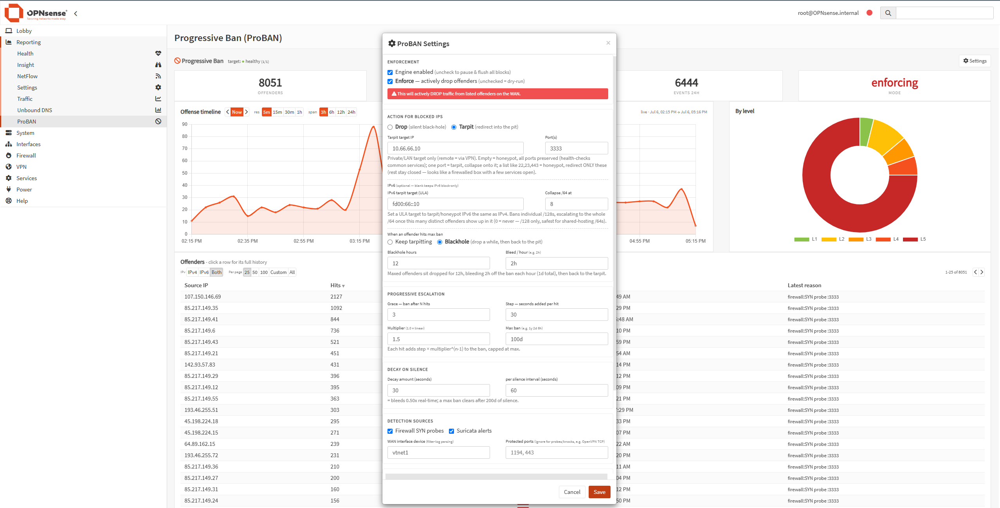

# ProBAN — Progressive Ban

**Progressive / parabolic banning of abusive IPs for OPNsense — with a resource-burning tarpit and honeypot redirect.**

ProBAN watches your firewall (and optionally Suricata) logs, and every time an IP probes your WAN it *grows* that IP's ban. The ban accelerates with each hit and decays during silence — so a drive-by scanner earns a 30-second timeout, while a persistent attacker digs itself into a ban measured in days, then months. Banned IPs can be silently **dropped**, funneled into a **tarpit** that wastes their time and sockets, or redirected to a **honeypot** on ports you choose — all rendered in a live dashboard under **Reporting → ProBAN**.

> **Status: packaged plugin, validated live on OPNsense 26.1.** The progressive engine, dashboard, and drop/tarpit/honeypot enforcement run and enforce on a live OPNsense box, wired up the proper OPNsense way — settings in a **model XML** (`config.xml`, so they're backed up and upgrade-safe), the engine as a **configd/rc.d service**, `config.json` generated from a **template**, and firewall rules owned by a **`plugins.inc.d` hook** (external alias + block / `rdr pass`). Verified end-to-end on OPNsense 26.1 / PHP 8.3: model load, template render, service lifecycle, firewall-rule generation, and the dashboard API. See [Status & Roadmap](#status--roadmap). Contributions and review welcome.



---

## Why

Fixed-tier fail2ban-style blocking treats the guy who fat-fingered your SSH once the same as the botnet hammering Telnet 10,000 times a day. ProBAN is **progressive**: the punishment fits the persistence, automatically, with no tiers to tune.

## How the ban works

Each offender has a **ban balance** (seconds):

- **Grows on every hit** — including hits that land *after* they're already blocked (PF address counters feed those back in without logging every dropped packet). Increment per hit `n` is `step × multiplier^(n-1)`, capped at a configurable maximum.
- **Decays linearly during silence** — a fixed amount per interval (default 30s per 60s). Stay quiet and your sentence bleeds off; keep knocking and it accelerates.
- **Blocked while balance > 0.**

That's the "parabolic" shape: accelerating up under active attack, linear decay when they give up. A one-off scanner is gone in a minute; a relentless one pins to the max ban and stays there.

### Quiet blocked traffic

ProBAN's drop rules run before CrowdSec and ordinary user filter rules and do not log individual packets. Initial detection still uses logged WAN TCP SYN probes and optional Suricata alerts. Once an address is blocked, the engine reads its incoming block counter from PF and stores one weighted event per address and cycle instead of one database event per packet. Tarpit/honeypot pass traffic continues to use the existing log-based detection; blackhole drops use counters.

The dashboard's **Hits**, **Last seen**, 24-hour total, timeline and per-address history include these batches. For example, 250 more dropped packets add 250 hits and one history row with source `pf`. PF counter collection normally runs every 60 seconds and the dashboard refreshes every 30 seconds; initial log-based detection now has a separate fast path described below. PF does not supply ports, TCP flags or individual packet times here: last-seen and batch timestamps indicate collection time. These counters include all incoming dropped packets from already-banned addresses, not just TCP SYN probes. Protected ports still exclude initial probes and tarpit knocks; they cannot be separated from an address's aggregate drop counter.

IPv6 `/64` counters are shown as separate subnet-total rows rather than attributing unknown packets to individual hosts. Existing history is retained during the database migration. The first snapshot of a pre-existing table is a baseline, not a replay of earlier traffic; subsequent counter changes and resets are tracked. If counters cannot be read, the dashboard warns and existing bans/tables are retained until collection recovers.

After deploying the updated files/package, reload the firewall to enable counters on new and existing ProBAN aliases and install the quiet rules, then run one collection cycle:

```sh
configctl filter reload
configctl proban run
```

Existing database rows and service settings do not need resetting. Native PF behavior still needs verification on the target OPNsense appliance; local automated tests use FreeBSD-format counter fixtures.

When upgrading from the older periodic supervisor, also run `configctl proban restart` after package installation to activate the persistent service. `configctl proban run` remains a bounded, single full cycle; it does not start the service.

## What happens to a banned IP — three actions, one setting

| Action | Behavior |
|---|---|
| **Drop** | Silent black-hole (default). |
| **Tarpit** | Redirect to a zero-window TCP tarpit that accepts, stalls, and holds the connection — burning the attacker's time and file descriptors while never reading their input (zero parser attack surface). |
| **Honeypot** | Redirect chosen service ports (e.g. `22,23,443`), *preserving the original port*, so it looks like a firewalled box with a few services left open — for a real emulator (Cowrie/T-Pot/honeytrap) to engage. |

The mode is chosen by the **Port(s)** field: empty = honeypot (all ports preserved), one port = tarpit (collapse onto it), a comma list = honeypot on just those ports.

### After max ban — the "blackhole" (optional)

By default a maxed-out offender just stays tarpitted. Flip on **blackhole** and, the moment an IP hits the ceiling, ProBAN parks it in a *drop* set for a while — no sense burning tarpit sockets on someone who's proven relentless — bleeding its ban down at an accelerated rate (escalation frozen while it's in there), then lets it back into the tarpit for another go. Keep abusing → hit max → back in the hole. A little hope, repeatedly dashed.

Two knobs (tarpit mode only): **`blackhole_hours`** — how long they sit dropped (default 12) — and **`blackhole_decay`** — how much ban each hour in the hole knocks off (default `2h`/hr). Under the hood it's a second pf table (`parabolic_drop`) that the engine routes maxed offenders into and the firewall hook blocks.

### IPv6

IPv6 gets the **same treatment as IPv4** — drop, tarpit, honeypot, *and* blackhole — not just a block. The engine parses v6 SYN probes (skipping the ICMPv6 that keeps v6 running) into a dedicated `parabolic_block6` table; when a private v6 (ULA) tarpit target is set, an `inet6` `rdr` redirects them into the pit exactly like v4, with an `inet6` blackhole (`parabolic_drop6`) for maxed-out offenders. Leave the v6 target blank to keep v6 block-only.

**Evidence-based /64 aggregation.** A v6 attacker usually controls a whole /64 and can rotate source addresses for free, so banning individual /128s is whack-a-mole — but a /64 can also be a *shared* hosting subnet, and blindly banning it would punish innocent neighbours. So ProBAN bans /128s and escalates to the whole /64 only once it has seen **≥ N distinct** offenders in that /64 (configurable; `0` = never). A lone bad tenant on a shared /64 keeps its neighbours; a rotating attacker gets the whole /64 trapped.

The allowlist takes precedence over subnet aggregation. If a proposed `/64` overlaps an allowlisted address or network, ProBAN keeps the individual offending hosts blocked instead of banning that subnet. This applies to fast updates, full reconciliation and blackhole tables. A full reconciliation replaces any existing overbroad entry with the safe host entries while retaining their history. Subnets with no allowlist overlap still aggregate normally.

## Optional scan detection and priority alerts

Two additional independent switches are disabled by default: **TCP SYN+FIN / SYN+RST** detects SYN combined with FIN or RST (including combinations with additional flags), using the existing packet threshold/window but counting separately from FIN/NULL/XMAS. **Portscan detection (distinct ports)** detects breadth rather than packet volume, with an editable default of **10 distinct destination ports in 60 seconds**, counted separately for each source IP, destination IP and TCP/UDP protocol. It works independently of the individual SYN/UDP/flag switches, while those switches may still trigger their own earlier bans when enabled.

Portscan tracking considers already-blocked WAN TCP SYN, FIN/NULL/XMAS, conflicting SYN flag combinations and UDP probes. Repeats on one port count once; normal ACK, RST, SYN-ACK and allowed traffic do not contribute. The port counts survive engine cycles and restarts, are cleaned during maintenance, and do not duplicate packet hits or history entries. Reasons include the flag combination or the number of distinct ports, target, protocol, window and threshold. Both new detections preserve the allowlist, protected ports, grace and existing ban limits. With portscan detection enabled, UDP bans and quiet counter feedback also work in tarpit mode.

Settings > Detection sources has separate switches for TCP SYN (enabled by default), UDP and TCP FIN/NULL/XMAS (both disabled by default). UDP and TCP-flag probes are counted separately for each source IP. Their default threshold is **5 probes within 60 seconds**; both values are editable. Only already-blocked incoming packets on the configured WAN are considered for the additional scan modes. Protected ports and allowlisted addresses are excluded. Normal ACK, RST and SYN-ACK packets, and allowed UDP traffic, are not classified as these scans.

Enabling UDP detection also installs quiet UDP drop rules for banned sources in tarpit mode, while keeping the TCP redirects unchanged. The threshold is an additional condition, not a bypass of the configured grace period. It limits single-packet false positives but cannot authenticate a source address: UDP and TCP-flag packets can be spoofed. These features classify suspicious traffic, not certain proof of an attacker.

Suricata priority bans are optional and disabled by default. When enabled, matching alerts can bypass the ordinary grace period and impose a minimum real-time ban (default **1800 seconds**) at the selected severity (default **1**, high). Optional signature IDs restrict priority treatment further; an empty ID list matches all signatures at the selected severity. The configured maximum ban still caps the result. Existing blackhole behavior, dry-run, the allowlist and protected ports are preserved; protected ports never receive the new priority escalation. Without a running Suricata producing alerts, this option has no effect and does not enable Suricata itself.

Reasons identify the probe type, destination and WAN, or the Suricata signature, SID, severity and destination. The overview prefers the latest detection reason over later PF counter updates. The original cause is retained while aggregate PF follow-up activity is stored separately in history. PF reasons describe additional incoming packets blocked during an active ban; they cannot identify individual ports, TCP flags or attack types. Existing historical text is not rewritten or reconstructed.

## Safety — built to be un-weaponizable

- **Reflection-locked** — the redirect target can only be a **private/LAN/VPN** address (RFC1918, loopback, CGNAT, IPv6 ULA). Public targets are rejected at the UI, the API, *and* by the engine. You can never turn it into an outbound reflection cannon aimed at a victim. Remote tarpits are reached over a VPN tunnel (which presents a private tunnel IP).
- **Tamper-evident** — the engine re-checks the live redirect target every run; if someone hand-edits the firewall rule to a public IP outside ProBAN, it flushes the block table and raises a dashboard alert.
- **Self-protecting allowlist** — private ranges and loopback are *always* unbannable, even if removed from the allowlist, so you can't lock yourself out.

## Dashboard

Under **Reporting → ProBAN**: live offender count / active blocks / events, a scrubbable offense timeline (5m–24h resolution, pan back/forward), a by-severity doughnut, a **click-to-sort** offender table with per-IP drill-down, a target health badge, and a settings panel for every knob (grace, step, multiplier, max-ban as `1y 2d`, decay, blackhole, allowlist, retention, protected ports).

The offenders table supports **pagination** (25 / 50 / 100 / custom / ALL rows) and an **IPv4 / IPv6 / Both** filter/switcher. Column sorting is preserved when you change page size or the IPv filter (sorting and pagination are coordinated server-side for the current view). Controls are always visible above the table.

**Search IP or prefix** filters stored addresses case-insensitively by literal text, including IPv6 subnet rows. Search works with the address-family and expiry filters, sorting and pagination; the dashboard-wide statistics remain independent of the search. If a data refresh fails, the last available values stay visible with a warning instead of being replaced by zeros or an empty table.

Per-address history has previous/next controls with 100 events per page, including IPv6 subnet totals. An open history keeps a stable snapshot while new traffic arrives; **Refresh history** starts again with the latest events. History remains subject to event retention. Time-window statistics, history and retention cleanup use database indexes, installed automatically on the next engine run without discarding existing records. The initial index build can take longer on large databases.

Under **Settings > Housekeeping**, **Automatically hide expired offenders** removes expired IPs from the overview and its offender total on refresh. It is off by default. This is an appearance filter only: hit counters, history and escalation remain intact, and an IP reappears automatically if it is banned again. Turn it off to show expired entries again; the existing retention and amnesia settings still govern actual data cleanup.

A **Protected ports** setting (comma/space separated) lets you exclude specific ports (e.g. OpenVPN/TCP, other services) from probe and knock counting. This, combined with smarter knock detection (only counts `pass,in` when action=tarpit, destination matches tarpit target IP, and port is in the configured set), keeps legitimate inbound TCP traffic from triggering bans while still escalating on real tarpit hits. UDP traffic does not trigger initial firewall-log detection, but dropped UDP packets from an already-banned address contribute to its PF counter. VPN tunnel IPs are protected via the built-in SAFETY ranges + allowlist. See the compatibility section below.

## Repository layout

```
Makefile  pkg-descr                       # FreeBSD/OPNsense port metadata
src/
  etc/
    inc/plugins.inc.d/proban.inc          # service registration + firewall hook (block / rdr+pass)
    rc.d/proban                           # rc.d service wrapper (daemon-supervised engine loop)
  opnsense/
    mvc/app/models/OPNsense/ProBAN/
      General.xml  General.php            #   settings model -> config.xml (typed, validated)
      ACL/  Menu/                         #   access control + Reporting menu entry
    mvc/app/controllers/.../ProBAN/       #   Index + API (Overview, Settings, Service) controllers
    mvc/app/views/OPNsense/ProBAN/        #   Volt dashboard
    scripts/OPNsense/Parabolic/           #   engine.py + supervisor + config.sample.json
    service/
      conf/actions.d/actions_proban.conf  #   configd actions (start/stop/restart/status/run)
      templates/OPNsense/ProBAN/          #   generates config.json + rc.conf.d from the model
docs/images/                             # screenshots
```

## The tarpit daemon — [tinypit](https://github.com/Freeflite/TinyPit)

The companion tarpit lives in its own repo: **[TinyPit](https://github.com/Freeflite/TinyPit)** — a tiny Rust/[tokio](https://tokio.rs) zero-window TCP tarpit. It accepts the handshake, sets a tiny receive buffer, and **never reads** — the attacker's probe jams the buffer, the kernel advertises a zero window, and their stack stalls in persist mode. It only dribbles a byte occasionally. Bounded by max-connections and per-source caps. Run it on an **isolated box in a hostile DMZ**, never on the router itself, and point ProBAN's tarpit target at it.

## Deploy — 0 → hero

ProBAN is two pieces that snap together: the **OPNsense plugin** (the brain — watches logs, grows bans, owns the firewall rules) and **[TinyPit](https://github.com/Freeflite/TinyPit)** (the muscle — a tiny tarpit daemon on an isolated box that holds the redirected attackers). *Drop* mode needs only the plugin; *tarpit / honeypot* mode adds TinyPit.

### 1. Build & install the plugin

Build the package on a **FreeBSD VM matching your OPNsense version** (recommended), then copy the resulting `.pkg` to the firewall and `pkg add` it there. You can build on the OPNsense box itself instead, but a stock appliance ships without build tools — install them first (`pkg install -y git`; `make` is already in the FreeBSD base).

```sh
git clone https://github.com/opnsense/plugins
git clone https://github.com/Freeflite/PROBan   # this repo — the plugin source (the cp below needs it)
cp -a PROBan plugins/security/proban            # drop this repo in as the plugin
cd plugins/security/proban
make DEVELOPER=1 install                         # symlink live for iteration
# or:  make package && pkg add work/pkg/*.pkg    # build + install the real .pkg
```

The `.pkg` post-install registers the model, renders `config.json` from the template, and starts the configd service — nothing hand-edited.

### 2. Stand up TinyPit *(tarpit / honeypot mode only)*

TinyPit is a hostile-traffic magnet, so it runs **off** the firewall — an LXC/VM on a segmented DMZ with **no LAN or internet egress** (a compromised tarpit must be a dead end). Full details in [TinyPit](https://github.com/Freeflite/TinyPit); the short version:

> **These commands run on the Linux DMZ box — not on OPNsense** (there's no systemd or cargo there). They need the Rust toolchain with the musl target (`rustup target add x86_64-unknown-linux-musl`) and your distro's C build tools (on Debian/Ubuntu: `apt install build-essential musl-tools`).

```sh
git clone https://github.com/Freeflite/TinyPit && cd TinyPit
# portable static binary — runs on any Linux regardless of glibc:
cargo build --release --target x86_64-unknown-linux-musl
install -m755 target/x86_64-unknown-linux-musl/release/tinypit /usr/local/bin/tinypit
cp tinypit.service /etc/systemd/system/ && mkdir -p /var/log/tinypit
systemctl enable --now tinypit                   # listens [::]:3333, dual-stack
```

Give the box a private IP ProBAN can reach (e.g. a honeypot-DMZ `10.66.66.10`). A *remote* TinyPit works too — reach it over a VPN tunnel; its private tunnel IP passes the reflection lock.

### 3. Wire them together

In **Reporting → ProBAN → Settings**:

- **Enable**, and set the **WAN interface** to your physical uplink (not a WireGuard iface).
- **Action → Tarpit** (or Honeypot); set **Target IP** to the TinyPit box and **Port(s)** to `3333`.
  *(one port = tarpit · comma-list `22,23,443` = honeypot preserving those ports · empty = honeypot on all)*
- *(optional)* **Protected ports** for any inbound TCP services you run (e.g. `1194, 443`).

Save. ProBAN writes the model to `config.xml`, regenerates `config.json`, restarts the engine, and its `plugins.inc.d` hook lays down the `rdr` that funnels banned IPs into TinyPit — no hand-edited rules.

### 4. Watch it work

Offenders fill the dashboard within a log-cycle. Banned IPs get redirected into TinyPit (its `connections.log` fills with `<epoch> <ip>`), every continued knock re-escalates the ban, and the offense timeline lights up. That's the loop: **the plugin decides *who*, TinyPit burns *their* time, and the knocks feed back to grow the sentence.**

**VPN and other inbound TCP services compatibility**

ProBAN only acts on TCP SYN packets (see `proban/ingest.py`). UDP-based VPNs (WireGuard, IPsec, OpenVPN/UDP) are invisible to it — no risk of banning tunnel clients or counting handshake attempts.

For TCP-based VPN servers (e.g. OpenVPN over TCP) or other legitimate inbound TCP services/port-forwards:
- Use the **Protected ports** field (comma- or space-separated, e.g. `1194, 443`) in Settings → Detection sources. These ports are skipped entirely for probe recording and "tarpit knock" escalation.
- Knock detection is now gated: a `pass,in` TCP SYN only counts as a tarpit knock if (a) action is tarpit, (b) the logged destination IP matches the configured tarpit target (v4 or v6), and (c) the port is in the tarpit set (or the set is empty for full honeypot).

This keeps real users from being treated as offenders while still escalating bans on actual tarpit/honeypot hits.

IPv6 is fully supported for tarpit/honeypot/blackhole (including pass/in knock detection when a v6 target is set) with the same logic, plus /64 aggregation.

Set the WAN interface to your physical untrusted uplink (not a WireGuard interface). VPN tunnel client IPs (private ranges or CGNAT) are protected by the built-in SAFETY ranges + your allowlist. See `proban/config.py:SAFETY`.

The Protected ports field appears in Settings under "Detection sources" (alongside the WAN interface field). The offenders table above the dashboard also has an IPv4/IPv6/Both filter and pagination controls (25/50/100/custom/ALL) that preserve column sorting.

## Efficient PF table updates

Each table synchronization reads the live table once, then sends added and removed addresses in at most two batches through `pfctl -T add/delete -f -`. For example, 1,000 additions and 1,000 removals need three processes instead of 2,001. Unchanged tables need only the read, with no table or counter-snapshot writes. Existing addresses and their packet-counter baselines are retained rather than flushing and rebuilding the table.

Every synchronization command has a 10-second timeout and checks its exit status. A failed command aborts the cycle instead of recording the synchronization as successful. PF operations that have already succeeded are not rolled back; the next cycle reads the live table again and reconciles remaining changes. These paths are regression-tested with mocked PF commands, not a measured appliance performance benchmark.

## Fast detection and load limits

The service keeps one Python process and database connection alive. Native BSD `kqueue` notifications wake it for log and configuration changes, with a one-second fallback check for missed notifications or unsupported platforms. Detection batches run at most once per second; a new ban is added through a non-destructive PF batch without waiting for full maintenance. The configured grace threshold, protected ports, allowlist and dry-run mode still apply. Full counter collection, decay, retention cleanup, IPv6 aggregation and table reconciliation normally run every 60 seconds. `PROBAN_INTERVAL` changes this maintenance interval, not the fast detection cadence. No PF states are killed.

Each source reads at most 1,000 records, 1 MiB, or approximately 250 ms of reading/parsing per batch, whichever limit is reached first. Database writes and PF commands complete separately, so this is not a hard CPU quota or a guaranteed one-second blocking latency under load. Consecutive identical events with the same address, source, reason and timestamp share one weighted database row; distinct timestamps are retained. The next batch resumes at the saved byte cursor, committed with its events. A remaining backlog is reported as `backlog=...B` in the service log.

Incomplete lines wait for their terminating newline. Records over 64 KiB are discarded incrementally, with discarded-record totals in SQLite state (`fw_offset_oversized` and `eve_offset_oversized`). File identity changes and truncation restart reading at the beginning of the current log. Backlogs continue without requiring another file-change notification, but unread data removed by log rotation cannot be recovered. Persistently higher input rates can therefore still exceed the processing and retention capacity.

The service is managed with the existing `configctl proban start|stop|restart|status` actions; `daemon(8)` forwards its output to syslog under `proban`. Local tests exercise native file notifications, bounded processing, simulated PF updates and a real unprivileged daemon's SIGTERM shutdown. FreeBSD service integration and attack-load performance still require verification on the target appliance.

## Testing

```sh
python -m unittest discover -s tests
```

The engine's ban math is pure and its DB-writing paths (`record` / `decay_pass` / `enforce`) take the timestamp as a parameter, so the suite is deterministic and needs no OPNsense or pf. It covers the progressive growth curve (grace + `step × mult^(n-1)` + max cap), linear vs. blackhole-accelerated decay, the private-target reflection lock, the two-table (`parabolic_block` / `parabolic_drop`) routing, protected ports + smarter (target/port-aware) knock detection, v4/v6 ingest, and the IPv6 /64 aggregation (shared-subnet safety + rotation capture) plus the v6 tarpit/blackhole split. Pagination and IPv filtering are exercised via the API + JS layers.

## Status & Roadmap

Working today: the progressive engine, dashboard, drop/tarpit/honeypot enforcement, post-max blackhole escalation, reflection-lock, tamper-evidence, health check.

Now wired the proper OPNsense way — **validated live on OPNsense 26.1**:

- [x] Config → **model XML** (typed fields + validation in `config.xml`)
- [x] Engine → a **configd/rc.d service** instead of a cron line
- [x] `config.json` generated from a **template** (engine reads it unchanged)
- [x] Firewall integration owned by a **`plugins.inc.d` hook** (external alias + block / rdr+pass), no stored UUIDs
- [x] `Makefile` / `pkg-descr` for a real FreeBSD port
- [x] Validated live on OPNsense 26.1 — model load, template render, service lifecycle, firewall-hook rule generation (block + `rdr pass`), and dashboard API
- [x] Tarpit daemon split into its own repo ([TinyPit](https://github.com/Freeflite/TinyPit))
- [x] Builds & installs as a real `.pkg` (`make package` → `pkg add`; the post-install migrates the model and reloads configd/templates)
- [x] Automated tests for the engine (25) — ban math, linear + blackhole-accelerated decay, progressive growth, v4/v6 parsing, two-table routing, **IPv6 /64 aggregation + v6 tarpit/blackhole split** (see [Testing](#testing))
- [x] **IPv6 tarpit parity** — v6 gets the same drop/tarpit/honeypot/blackhole path as v4 (`inet6` `rdr` + `parabolic_block6` / `parabolic_drop6`), with **evidence-based /64 aggregation** (ban /128s, escalate to the /64 only at *N* distinct offenders, so a shared hosting /64 keeps its neighbours). Validated live on OPNsense 26.1 over a ULA honeypot DMZ.
- [x] i18n-ready — every dashboard string wrapped in `lang._()` (JS via a translated lookup with reorderable placeholders); model/menu/ACL auto-extract; flows into `make translate` / Weblate
- [ ] (someday) federated abuser-intel: mTLS reporting to a central aggregator + shared reputation feed

## License

BSD 2-Clause — see [LICENSE](LICENSE).

**Attribution to [github.com/Freeflite/ProBAN](https://github.com/Freeflite/PROBan) is required** if used in any derivative work, product, package, or distribution.
